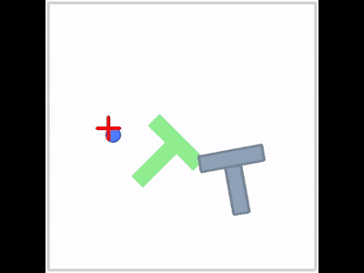

# 22-Day Robotics Challenge

Follow along: [@anmol_bajpai24](https://x.com/anmol_bajpai24)

Learning robotics in public, one day at a time. A game developer's first
contact with imitation learning, new to both robotics and Python. One project
across all 22 days: run pretrained policies, train my own, and build the eval
dashboard that keeps every number honest.

See [CONCEPTS.md](CONCEPTS.md) for a short write-up of each research-morning
idea, and [docs/X_POSTS.md](docs/X_POSTS.md) for the daily posts themselves.



**Live dashboard:** <https://robotics-challenge-dashboard.onrender.com>.
Leaderboard, per-episode metrics, and rollout videos, served straight from the
evidence files in this repo. Free tier: the first load after it idles takes
about a minute to wake up.

## The leaderboard

Every number carries a protocol label, because comparisons only mean something
within one ruler.

**PushT**: frozen-500 protocol (LeRobot 0.6.0, `lerobot-eval`):

| policy | success | notes |
|---|---|---|
| pretrained-diffusion | **61.0%** | official `lerobot/diffusion_pusht` checkpoint, migrated |
| diffusion-scratch | **39.8%** | mine, 90k steps, one overnight on an RTX 4060 |
| act-pusht | **0.8%** | ACT at default settings, an honest failure, kept on the board |

**xarm**: frozen-500 protocol (hand-written BC loop, day 14 onward; lift
success is cube ≥ 15cm above spawn, push success is cube within 5cm of goal):

| policy | success | notes |
|---|---|---|
| bc-mlp-sighted | **99.0%** | lift, oracle demos, cube xyz in the state vector |
| bc-mlp-push | **98.8%** | push, oracle demos, same recipe pointed at a new task |
| bc-mlp-blind-control | **4.2%** | lift, same oracle demos, cube stripped from the state (the ablation) |
| bc-mlp-blind | **0.0%** | lift, TD-MPC demos, no cube in state |

Off-ruler results (real numbers, different protocols, listed separately on
purpose): ACT-pusht hits 11% with `n_action_steps=8` (inference knob sweep);
pretrained ACT on ALOHA transfer-cube got 7/10 over 10 episodes; the scripted
xarm oracle goes 20/20 but reads the true cube position (it exists to validate
the benchmark, not to compete on it).

## The frozen protocols (the rulers)

- **PushT frozen-500:** 500 episodes, `batch_size=4`, `use_async_envs=false`,
  seed 1000, cuda. Established day 1, never changed. ±4 pts sampling error.
- **xarm frozen-500:** 500 episodes, `reset(seed=1000+i)`, 300-step cap,
  success = cube ≥ 15cm above spawn (patched success check). Established day 14.

Runs on the frozen ruler are labeled `frozen-500` by the API; everything else
is `exploratory`. Each run also carries a provenance label — whether its launch
command survives in a committed log or only in bash history (day 9).

## The dashboard

FastAPI backend ([dashboard/main.py](dashboard/main.py)), a read-only API over
the `eval_info.json` files that `lerobot-eval` writes for PushT, plus a
read-only parser for the plain-text eval logs the hand-written xarm BC loop
produces (day 14, day 16, day 21). It never re-runs anything and never writes
into evidence dirs. Both the PushT and xarm leaderboard tables pull their
rows live from `/summary`, the same way, falling back to numbers embedded in
the frontend when the API is down. React + Vite frontend
([dashboard/frontend/](dashboard/frontend/)), built into `dashboard/static/`
and served by the same process.

Endpoints: `/summary`, `/runs`, `/runs/{id}`, `/runs/{id}/metrics`,
`/curves/skill`, `/videos`, `/health`.

## Run it locally

The dashboard needs only Python 3.12 and three pinned packages — not LeRobot:

```bash
git clone https://github.com/anmolbajpai24/robotics-challenge.git
cd robotics-challenge
python3 -m venv .venv && source .venv/bin/activate
pip install -r requirements.txt
uvicorn dashboard.main:app --port 8011
# open http://127.0.0.1:8011
```

To hack on the frontend: `cd dashboard/frontend && npm install && npm run dev`
(proxies to :8011), and `npm run build` to regenerate `dashboard/static/`.

Reproducing the training/eval runs themselves needs LeRobot 0.6.0 with the
matching extras (`[pusht]`, `[diffusion]`, `[act]`, `[training]`) and a CUDA
GPU; each `dayN/` directory documents what ran and how.

## Repo map

- `dayN/`: evidence per day, scripts, logs, eval results, rollout videos, notes
- `outputs/eval/`: the day-1/2 pretrained-diffusion baseline evidence
- `dashboard/`: FastAPI backend, React frontend, built static bundle
- `day9/provenance.md`: which run commands are backed by committed logs
- `CONCEPTS.md`: a short write-up of each research-morning idea
- `docs/X_POSTS.md`: every day's X post, verbatim, the source of truth for the docs
- checkpoints (~1-3GB each) live on an external drive, not in git

## Day log

Day numbers below are the X post numbering (1 to 22), not the folder names.
Folder names follow when the work actually got done, not the X day count, so
they don't always line up: day 4's result is in `day3/`, day 13's is in
`day12/`, day 15's is in `day14/`, days 19 and 20 both landed in `day19/` and
`dashboard/`, and day 22's is in `day20/`. See [CONCEPTS.md](CONCEPTS.md) for
the research idea behind each morning post.

| day | what happened | evidence | post |
|---|---|---|---|
| 1 | pretrained diffusion policy on PushT, 61.0% over 500 episodes, the frozen ruler established | [day1_pusht.gif](day1_pusht.gif), [outputs/eval/](outputs/eval/) | [post](https://x.com/anmol_bajpai24/status/2077671346696577392) |
| 2 | opened the 206-demo PushT dataset: 96x96 thumbnails, the first demo overshoots and recovers | [day2/](day2/) | [post](https://x.com/anmol_bajpai24/status/2078049330519564633) |
| 3 | started training a 263M-param diffusion policy from scratch, 90k steps overnight on the RTX 4060 | [day3/](day3/NOTES.md) | [post](https://x.com/anmol_bajpai24/status/2078454656704069734) |
| 4 | overnight run finished: 90k steps in 10h41m, 39.8% on the frozen-500 ruler vs the pretrained model's 61.0% | [day3/](day3/NOTES.md) | [post](https://x.com/anmol_bajpai24/status/2078780417772274042) |
| 5 | trained ACT: 0.8% at default settings on the frozen ruler, 11% off-ruler after tuning the chunk-size knob | [day5/](day5/) | [post](https://x.com/anmol_bajpai24/status/2079171442688876656) |
| 6 | tried SmolVLA on PushT: pads to 32 dims so nothing crashes, but the arm-trained brain's numbers don't mean the right thing here | [day6/](day6/NOTES.md) | [post](https://x.com/anmol_bajpai24/status/2079461377769615851) |
| 7 | pretrained ACT on ALOHA transfer-cube, the body it was built for: 7/10 | [day7/](day7/) | [post](https://x.com/anmol_bajpai24/status/2079852457740374311) |
| 8 | no post | TODO(anmol) | TODO(anmol) |
| 9 | reconstructed policy provenance for all 15 historical runs, corrected day 5's ACT number to its honest on-ruler 0.8% | [day9/](day9/provenance.md) | [post](https://x.com/anmol_bajpai24/status/2080636744140296256) |
| 10 | shipped the eval API: `/summary`, per-run metrics, the day-4 skill curve served live | [dashboard/](dashboard/main.py) | [post](https://x.com/anmol_bajpai24/status/2081029985272492296) |
| 11 | read a paper from Karen Liu's lab at Stanford; no evening update, paper and takeaway not recorded | TODO(anmol) | [post](https://x.com/anmol_bajpai24/status/2081281867500920977) |
| 12 | filmed a hand passing a matchbox, retargeted it onto the ALOHA sim via MediaPipe: 0 success, closest approach about 2cm | [day12/](day12/NOTES.md) | [post](https://x.com/anmol_bajpai24/status/2081691923090378780) |
| 13 | measured the sim's commanded-vs-reached gripper position: off by several centimeters, pose-dependent, from a soft weld | [day12/](day12/NOTES.md) | [post](https://x.com/anmol_bajpai24/status/2081978960754421789) |
| 14 | wrote a BC training loop by hand for xarm lift | [day14/](day14/RESULTS.md) | [post](https://x.com/anmol_bajpai24/status/2082485597248295152) |
| 15 | first xarm frozen-500 benchmark: 0/500; a scripted oracle confirms the bench itself works (20/20) | [day14/](day14/RESULTS.md) | [post](https://x.com/anmol_bajpai24/status/2082827912131248297) |
| 16 | added the cube's position to the input: same benchmark, 99.0% sighted vs 4.2% blind control | [day16/](day16/RESULTS.md) | [post](https://x.com/anmol_bajpai24/status/2083186440419365314) |
| 17 | read a paper from Imperial on teaching a robot 1,000 tasks in a day via demo retrieval instead of training | no repo folder, reading day | [post](https://x.com/anmol_bajpai24/status/2083459466117468550) |
| 18 | read about π0.7 operating an air fryer it was never trained on, from two demo episodes | no repo folder, reading day | [post](https://x.com/anmol_bajpai24/status/2083797946617708840) |
| 19 | dashboard leaderboard shipped, pulling frozen numbers live from the eval API | [day19/](day19/RESULTS.md), [dashboard/](dashboard/main.py) | [post](https://x.com/anmol_bajpai24/status/2084240745809277101) |
| 20 | episode player shipped: curated rollout clips next to the numbers they produced | [day19/](day19/RESULTS.md), [dashboard/](dashboard/main.py) | [post](https://x.com/anmol_bajpai24/status/2084521967286390852) |
| 21 | xarm push task: resurrected a deprecated gym-xarm env, 98.8% on the frozen-500 ruler | [day21/](day21/RESULTS.md) | [post](https://x.com/anmol_bajpai24/status/2084888885054844963) |
| 22 | dashboard pushed live at the public Render URL | [day20/](day20/RESULTS-deploy.md) | [post](https://x.com/anmol_bajpai24/status/2085242213345136699) |
